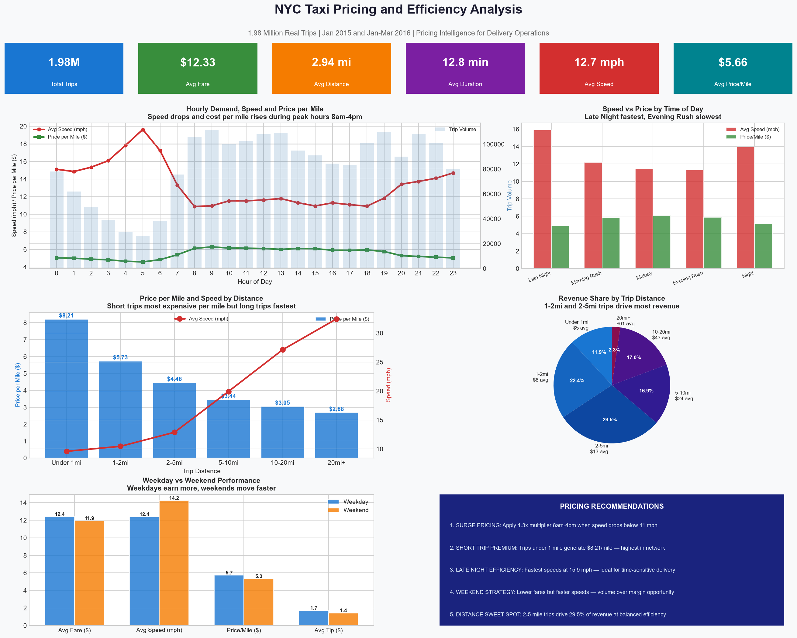

# Pricing and Efficiency Analysis
## Urban Delivery Pricing Intelligence from 1.98M Real Trips

### Project Overview
Pricing and efficiency analysis on 1.98 million real NYC taxi
trips to identify surge pricing opportunities, revenue sweet
spots, and time-of-day efficiency patterns directly applicable
to urban delivery platform pricing decisions.

**Tools:** Python, Pandas, NumPy, Matplotlib, Seaborn,
Jupyter Notebook
**Dataset:** NYC Yellow Taxi Trip Data 2015-2016 (Kaggle)
**Scale:** 1,979,249 trips analysed

---

### Pricing and Efficiency Dashboard

---

### Finding 1 — Peak Hours Kill Efficiency

| Time Period | Avg Speed | Price per Mile |
|------------|-----------|----------------|
| Late Night | 15.9 mph | $4.89 |
| Morning Rush | 12.2 mph | $5.86 |
| Midday | 11.5 mph | $6.09 |
| Evening Rush | 11.3 mph | $5.87 |
| Night | 14.0 mph | $5.16 |

Speed drops 41% from Late Night to Evening Rush.
Cost per mile rises during peak hours to compensate
for lower delivery efficiency in congested conditions.

---

### Finding 2 — Short Trips Are Most Profitable per Mile

| Distance | Price per Mile | Avg Speed |
|----------|---------------|-----------|
| Under 1mi | $8.21 | 9.6 mph |
| 1-2mi | $5.73 | 10.5 mph |
| 2-5mi | $4.46 | 12.9 mph |
| 5-10mi | $3.44 | 19.9 mph |
| 10-20mi | $3.05 | 27.1 mph |
| 20mi+ | $2.68 | 32.5 mph |

Price per mile drops 63% from short to long trips.
Long trips move faster but generate less per mile.

---

### Finding 3 — Revenue Sweet Spot is 1 to 5 Miles

- 2 to 5 mile trips: 29.5% of all revenue
- 1 to 2 mile trips: 22.4% of all revenue
- Combined: 52% of total revenue

The 1 to 5 mile range is the optimal zone for
urban delivery pricing — balancing speed,
volume, and revenue per trip.

---

### Finding 4 — Weekday vs Weekend Trade-Off

| Metric | Weekday | Weekend |
|--------|---------|---------|
| Avg Fare | $12.40 | $11.93 |
| Avg Speed | 12.4 mph | 14.2 mph |
| Avg Tip | $1.70 | $1.42 |

Weekends are 15% faster but generate 4% less fare
and 16% less tip. Weekdays are higher value,
weekends are higher volume opportunity.

---

### Pricing Recommendations

1. **SURGE PRICING** — Apply 1.3x multiplier 8am to 4pm
   when speed drops below 11 mph. Compensates for lower
   delivery efficiency during peak congestion.

2. **SHORT TRIP PREMIUM** — Trips under 1 mile generate
   $8.21 per mile. Maintain minimum fare floor to
   protect margin on short trips.

3. **LATE NIGHT EFFICIENCY** — Fastest speeds at 15.9 mph
   make late night ideal for time-sensitive deliveries.

4. **WEEKEND VOLUME STRATEGY** — Price for volume on
   weekends rather than margin optimisation.

5. **DISTANCE SWEET SPOT** — Build pricing model around
   the 2 to 5 mile range which drives 29.5% of revenue
   at balanced speed and cost efficiency.

---

### How to Run

1. Clone this repository
2. Download NYC Taxi dataset from Kaggle
3. Install: pip install pandas numpy matplotlib
   seaborn jupyter
4. Open: jupyter notebook
5. Run: Pricing_Efficiency_Analysis.ipynb

---

### About
Portfolio project by Sankruth Sriram — Supply Chain
and Operations Analytics Professional based in Berlin.

LinkedIn: linkedin.com/in/sankruth-sriram
GitHub: github.com/xhamaniksanta
